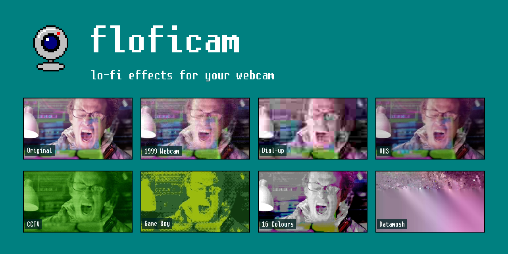
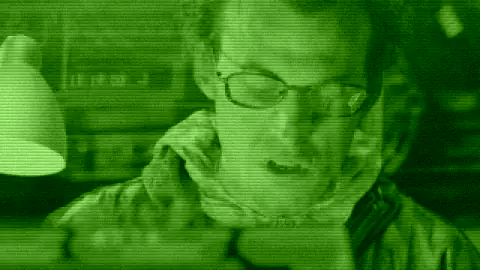

<p align="center"></p>

# floficam

floficam makes your webcam look worse on purpose. It reads the real camera through PipeWire, pushes every frame through a lo-fi effect (a 1999 webcam, a worn VHS tape, a Game Boy camera, a dial-up stream that keeps stalling) and writes the result to a v4l2loopback device. Browsers, Zoom, OBS and anything else that lists cameras see one more, called `floficam`, and use it like any other.

- The real camera is opened only while something reads the virtual one, so its light stays off between calls.
- When the camera stalls or disappears, the device switches to SMPTE colour bars.
- You switch effects by editing a JSON file, and the next frame uses the new one, with no restart.
- A broken settings file also gives you bars, so a typo never puts the unfiltered camera on screen.
- Pausing freezes the picture on the current frame.

## Presets

Each clip is the same six seconds through one built-in preset, rendered by the code in this repo ([`tools/render-demos.py`](tools/render-demos.py)). All eight side by side at full size: [`docs/media/presets.mp4`](docs/media/presets.mp4).

| | |
|---|---|
| <br>`none`: the camera as it is. This is also what you get without a `filter.json`. | <br>`1999-webcam`: 320 px at 15 fps, the 216-colour web-safe palette with a 4×4 dither, some ghosting, and JPEG at quality 25. |
| <br>`dial-up`: 160 px, 8 levels per channel, 2 fps, JPEG at quality 8, and about eight one-second stalls a minute. | <br>`vhs`: 640 px, interlaced, with the colour shifted and smeared, scanlines and grain, through VP8 at 600 kbit/s. |
| <br>`cctv`: 320 px at 5 fps, a green monitor tint, heavy scanlines and grain. | <br>`game-boy`: 160 px, four shades of green with a 4×4 dither, scaled back up with hard pixel edges. |
| <br>`16-colours`: 640 px, the 16-colour Windows palette with an 8×8 dither. | <br>`datamosh`: VP8 at 300 kbit/s with half the delta frames kept from the decoder, so new motion lands on stale pixels until the next keyframe, at most three seconds away. Fast motion like this clip's turns to mush; a face that mostly sits still holds together longer. |

## Install

floficam is a Nix flake with a NixOS module for the loopback device and a home-manager module for the user service. It needs PipeWire and `v4l2loopback` 0.15.4 or newer.

```nix
{
  inputs.floficam = {
    url = "git+https://git.florkiewicz.me/mesh/floficam";
    inputs.nixpkgs.follows = "nixpkgs";
  };
}
```

In your NixOS configuration:

```nix
{
  imports = [ inputs.floficam.nixosModules.default ];
  # /dev/video10, named "floficam", with a stable /dev/floficam link
  programs.floficam.loopback.enable = true;
}
```

In home-manager:

```nix
{
  imports = [ inputs.floficam.homeManagerModules.default ];
  services.floficam = {
    enable = true;
    camera = "<your camera's node.name>";
  };
}
```

The service starts with your graphical session once the device exists, and udev starts it again if the kernel module is reloaded. `camera` names a PipeWire node. To find yours, run `wpctl status`, take the camera's id from Video › Sources, and look it up with `wpctl inspect <id> | grep node.name`. The default, `external`, leaves the input unconnected for a WirePlumber script or `pw-link` to connect. Automatic camera selection is planned (see [Status](#status)).

To see the output, run `mpv av://v4l2:/dev/floficam` or `ffplay -f v4l2 /dev/floficam`.

### Without NixOS

The home-manager module works on any distribution. Set up the device the way the NixOS module would:

```sh
# /etc/modprobe.d/floficam.conf
options v4l2loopback devices=1 video_nr=10 card_label="floficam" exclusive_caps=0 max_buffers=2

# /etc/udev/rules.d/90-floficam.rules
SUBSYSTEM=="video4linux", ATTR{name}=="floficam", TAG+="systemd", ENV{SYSTEMD_USER_WANTS}="floficam.service", SYMLINK+="floficam"
```

Then `modprobe v4l2loopback`. Without home-manager, run the daemon directly: `nix run git+https://git.florkiewicz.me/mesh/floficam -- --device /dev/floficam --camera <node.name>`.

## Picking an effect

The effect comes from `~/.local/state/floficam/filter.json` (`$XDG_STATE_HOME/floficam/filter.json` if you set that):

```json
{ "version": 1, "preset": "vhs" }
```

Overrides change a few knobs without copying the whole preset:

```json
{ "version": 1, "preset": "vhs", "overrides": { "analog": { "grain": 0.4 }, "temporal": { "fps_cap": 10 } } }
```

Delete the file to get the plain camera back. Write it atomically (to a temporary file, then `mv` it into place) so the daemon never reads a half-written one.

## Your own presets

Your presets go in `~/.local/state/floficam/presets.json`, in the same format as the [built-in ones](floficam/filter/presets.json):

```json
{
  "version": 1,
  "presets": [
    {
      "id": "security-desk",
      "name": "Security desk",
      "knobs": {
        "temporal": { "fps_cap": 2 },
        "picture": { "width": 256, "tint": "mono" },
        "analog": { "scanlines": 0.6, "grain": 0.5 }
      }
    }
  ]
}
```

Select one by its `id` in `filter.json`. An id can't contain whitespace or reuse a built-in id. A preset with a bad knob is skipped, the rest of the file still loads, and the journal says what was skipped and why.

### Knobs

Every knob is optional. Each default leaves the picture alone, so a preset only lists what it changes.

| Knob | Values | Default |
|---|---|---|
| `temporal.fps_cap` | 30, 15, 10, 5, 2, 1 | 30 |
| `temporal.stalls_per_min` | 0 to 20 | 0 |
| `temporal.stall_len_s` | 0.2 to 3 | 1 |
| `picture.width` | 1280, 640, 320, 256, 160 (height follows) | 1280 |
| `picture.upscale` | `blocky`, `soft` | `blocky` |
| `picture.shutter` | 0 to 0.95: how much of the previous frames lingers | 0 |
| `picture.tint` | `none`, `mono`, `sepia`, `cctv` | `none` |
| `picture.colour` | `true`, `posterize`, `palette` | `true` |
| `picture.levels` | 2 to 64 levels per channel, for `posterize` | 8 |
| `picture.palette` | `2`, `cga`, `gameboy`, `win16`, `web216` | `web216` |
| `picture.dither` | `none`, `bayer4`, `bayer8` | `none` |
| `codec.kind` | `off`, `jpeg`, `vp8` | `off` |
| `codec.jpeg_quality` | 1 to 100 | 50 |
| `codec.vp8_kbps` | 16 to 2000 | 600 |
| `codec.mosh` | 0 to 1: the share of VP8 delta frames kept from the decoder | 0 |
| `analog.interlace` | `true`, `false` | `false` |
| `analog.chroma_shift` | 0 to 16 px | 0 |
| `analog.chroma_smear` | 0 to 16 px | 0 |
| `analog.scanlines` | 0 to 1 | 0 |
| `analog.grain` | 0 to 1 | 0 |

## Pause

```sh
systemctl --user kill -s USR1 floficam   # freeze on the current frame
systemctl --user kill -s USR2 floficam   # live again
```

The freeze happens before the effect, so a paused VHS picture keeps its moving grain. A pause is refused when there's no fresh frame to freeze, and the journal says why. While paused, `$XDG_RUNTIME_DIR/floficam-paused` exists. If the daemon restarts in the meantime, it comes back paused and shows a placeholder card.

## Status

`systemctl --user status floficam` shows the daemon's status line, for example `camera=live filter=vhs`. `filter=error` means `filter.json` or your presets file didn't load, and `journalctl --user -u floficam` says why.

floficam works day to day, but its interface is still settling. Planned next:

- `--camera auto`, so it finds the webcam by itself
- a `floficam` command to switch presets, pause and preview
- a tray icon
- a video file or a still picture as the source, instead of the camera
- `exclusive_caps=1`, for apps that only list capture-only devices

## Development

```sh
nix develop          # Python, GStreamer, pytest
pytest               # unit tests
nix flake check -L   # the package, module assertions, and a NixOS VM test that loads v4l2loopback
nix fmt              # nixfmt
```

`floficam-filter-bench` times every preset on synthetic frames and fails if one takes over 100 ms a frame. To re-render this README's media from any clip:

```sh
nix run .#render-demos -- some-clip.mp4 --start 380 --duration 6
```

CI ([`.github/workflows/ci.yml`](.github/workflows/ci.yml)) runs the same checks on x86_64 and aarch64, and the VM test on x86_64. [Renovate](renovate.json) keeps `flake.lock` and the CI actions current.

## Licence

GPL-2.0-or-later, see [COPYING](COPYING).

The demo footage is from [*Tears of Steel*](https://mango.blender.org) (6:20 to 6:26, cropped to 16:9), © Blender Foundation, licensed [CC BY 3.0](https://creativecommons.org/licenses/by/3.0/). The wordmark font is [unscii](http://viznut.fi/unscii/), public domain.
